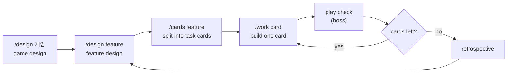

# unreal-claude-studio

[한국어](README.md) | **English**

A Claude Code setup that runs like an Unreal Engine game studio. The solo developer is the "boss"; Claude splits the work like a team: game design, breaking work into task cards, C++, editor work, tests and code review.

- Built for Unreal Engine 5.8, C++ projects, Windows
- Editor work goes only through Epic's official UE MCP toolsets
- The boss makes decisions and play-tests; everything else follows a fixed process

> The studio's instructions (agents, skills, rules) are written in Korean, and `CLAUDE.md` tells Claude to talk to you in Korean. To work in English, change that line in `CLAUDE.md`. Claude follows the Korean instructions either way.

## At a glance



One card (`/work`) goes through these steps:

```
start the card (decide how to build it) → build → C++ review → editor work → tests → test review → play check → wrap-up
```

## Installation

### Requirements

- Windows, Unreal Engine 5.8 (Epic launcher install recommended), a C++ Unreal project
- [Claude Code](https://code.claude.com) 2.1.295 or later
- Git for Windows (hooks run in Git Bash) and Git LFS
- Epic's Claude Code plugin `unreal-engine-skills-for-claude-code` (official marketplace). Install it with `/plugin` in Claude Code

For a Blueprint-only project, add one C++ class in the editor to turn it into a C++ project first.

### Install

```powershell
git clone https://github.com/Junghyeon0710/unreal-claude-studio.git
cd unreal-claude-studio
powershell -ExecutionPolicy Bypass -File install.ps1 "D:\Unreal Projects\MyGame"
```

What `install.ps1` does:

- Copies `.claude/` (agents, skills, rules, hooks, settings) and `Scripts/` into the project.
- Writes `CLAUDE.md`, `docs/`, `.gitignore`, `.gitattributes`, `.mcp.json` and a smoke test from `templates/`, with the project name and engine filled in.
- Enables the `ModelContextProtocol` and `AllToolsets` plugins in the `.uproject`, and turns on MCP server auto-start in the per-user editor settings.
- **Never overwrites an existing file.** Files whose content differs are listed so you can merge them. It is safe to run more than once.

### After installing

1. Add the two lines the script prints to the constructor in `Source/<Project>/<Project>.Build.cs`. You can also ask Claude: "add the two Build.cs lines from the install notes".

   ```csharp
   PublicIncludePaths.Add(ModuleDirectory);   // include feature headers as "<Feature>/<File>.h"
   if (Target.bBuildEditor)
   {
       PrivateDependencyModuleNames.Add("CQTest");   // automation tests that need a world
   }
   ```

2. Open Claude Code in the project folder and **accept the folder trust prompt**. Hooks only run after that.
3. Check the setup (or ask Claude to "check the install"):
   - `Scripts\build.bat`: build
   - `Scripts\test.bat`: the smoke test `<Project>.Smoke` passes
   - `Scripts\editor.bat open`: start the editor and wait until MCP answers
   - `Scripts\editor.bat close`: close the editor
4. If the project is not a Git repository yet, run `git init` and `git lfs install`. Assets (`.uasset`, `.umap`) go to LFS.

The scripts find the engine folder from the `.uproject`'s engine version (Epic launcher install list, then the registry). If your engine is somewhere else, set the `UE_ROOT` environment variable to the engine folder.

## Usage

Use the slash commands or just ask in plain words.

### 1. Game design: `/design 게임`

(`게임` means "game"; it is the keyword the skill looks for.) Claude asks one question at a time, sums up each group of answers, and writes only what you approve to `docs/design/game.md`: a one-line pitch, three core fun points, first-version features, build order and when to stop.

- No idea yet? Say "I don't know, suggest something". Claude asks about a game you like and offers two or three one-line concepts.
- Want fewer questions? Say "decide the rest yourself". Claude fills the remaining fields with its recommendations and asks you once at the end.
- Before confirming, a fresh read-only subagent checks "could someone build from this document alone?".

### 2. Feature design: `/design dash`

Defines one feature (for example, a dash): rules, how things are measured, tuning values, edge cases and completion conditions, written to `docs/design/dash.md`. Feature names are lowercase English. The design says what the feature does, not how to build it (no classes, no C++ vs Blueprint).

### 3. Task cards: `/cards dash`

Splits a confirmed design into 2 to 5 cards (for example `docs/tasks/001-dash-move.md`). Every completion condition in the design lands in exactly one card.

Small things like a value tweak or a bug become a single card without a design: "dashing into a wall gets me stuck, make a card for it".

### 4. Build a card: `/work 001`

Takes one card to done. The points where Claude asks you are fixed:

| Step | Who | What you are asked |
|---|---|---|
| Start the card | main | structural choices (with a recommendation), approve the card |
| Build | main | only if a structural change the card does not cover is needed |
| C++ review | `ue-reviewer` | nothing |
| Editor work | `ue-editor` | whether to commit before changing many assets |
| Tests | `ue-qa` | only if a test approach must be chosen |
| Test review | `ue-reviewer` | nothing |
| Play check | boss | play the checklist and say if it is good |
| Wrap-up | main | whether to commit |

- Claude opens and closes the editor (`Scripts\editor.bat`). It saves first and never force-closes.
- If the same problem needs more than three fix rounds, Claude stops and tells you.
- Decisions made without asking you are logged in the card as `판단:` (decision).

### 5. Pick up where you left off

When you open a new conversation, the session start hook tells Claude the card in progress, the next steps, uncommitted changes and whether the editor is running. Just say "let's continue". Claude resumes from the last step in the card's progress log.

### 6. Retrospective

When all cards of a feature are done, Claude collects the places where the studio itself got in the way and writes them under "스튜디오 개선" (studio improvements) in `docs/progress.md`. Studio settings are not changed on the spot; you decide on them separately.

## The team

| Name | Role | Can write to |
|---|---|---|
| Main Claude | design conversations, splitting cards, C++, opening and closing the editor, coordinating the team | the whole project |
| `ue-editor` | editor work (Blueprints, input, levels, assets). Official toolsets only; when a tool is missing it reports the tool it needs instead of working around it | its memory folder |
| `ue-qa` | writes and runs automation tests (Automation Spec, CQTest), play-check lists | test folders, `docs/tasks/`, its memory folder |
| `ue-reviewer` | reviews C++, tests and project toolsets against Epic's C++ coding standard. Reports only, never edits | its memory folder (Bash limited to read-only git) |
| `ue-programmer` | C++ for an independent card handed off on its own | `Source/`, `Plugins/`, `docs/tasks/` |

Hooks enforce the write limits. Agents cannot write to the engine folder or other projects either.

## What gets installed

```
<Project>/
├── CLAUDE.md                     project guide: engine, commands, folders, team, workflow, rules
├── .mcp.json                     UE MCP address (http://127.0.0.1:8000/mcp)
├── .claude/
│   ├── agents/                   ue-editor, ue-qa, ue-reviewer, ue-programmer
│   ├── skills/
│   │   ├── design/               /design and the design templates (game, feature)
│   │   ├── cards/                /cards and the card template
│   │   ├── work/                 /work, building one card
│   │   └── editor-tool-request/  what to do when no official tool exists
│   ├── rules/
│   │   ├── ue-cpp.md             C++ rules (loaded when a C++ file is opened)
│   │   ├── ue-blueprint-cpp.md   what goes in C++ and what in Blueprint
│   │   └── ue-assets.md          asset name prefixes and folders
│   ├── hooks/                    write limits, read-only git, session start summary
│   └── settings.json             blocks direct .uasset/.umap edits, wires the session start hook
├── Scripts/
│   ├── build.bat                 build the editor target
│   ├── test.bat                  command-line automation tests (e.g. test.bat MyGame.Dash)
│   ├── editor.bat                editor open | close | status
│   ├── ue-root.ps1               finds the engine folder
│   └── ue-python.bat             runs an approved one-off editor script
├── docs/
│   ├── progress.md               progress log, next steps, studio improvements
│   ├── design/                   design documents
│   └── tasks/                    task cards
└── Source/<Project>/Tests/<Project>SmokeSpec.cpp   a test that always passes
```

## Rules and safeguards

- **Assets:** `.uasset` and `.umap` cannot be edited as files. Assets are changed only in the editor.
- **Write limits:** each agent has fixed folders, enforced by hooks. If a hook cannot run, the write is blocked, not allowed (`onFailure: block`).
- **Editor:** never force-closed. If a save dialog is open, the script waits and reports it.
- **Commits:** only when the boss asks. Before changing many assets, Claude asks whether to commit first.
- **No guessing:** if an engine API is unclear, Claude checks the actual declaration in the engine source.
- **C++:** Unreal basics, Epic's C++ coding standard, readable code, structure and dependencies (`ue-cpp.md`). C++ is the base; Blueprint is for asset wiring, cosmetics, UI layout and prototypes (`ue-blueprint-cpp.md`).

## Editor and MCP

- The main conversation connects to MCP (`.mcp.json`) only if the editor was running when the conversation started.
- That is why `ue-editor`, `ue-qa` and `ue-programmer` declare their own MCP server in their agent settings (`mcpServers`, named `unreal-editor`) and connect each time they are called. Editor work still works if the editor is opened mid-conversation.
- `Scripts\editor.bat open` passes the MCP start flag, so the server starts even if auto-start is off.

## When no official tool exists

Following Epic's recommendation (the `create-toolset` skill), Claude builds the tool instead of working around it.

1. `ue-editor` reports the tool it needs (what it does, inputs, outputs) and stops.
2. The main session asks you; if you approve, it adds the tool and its tests to the project toolset (`Plugins/<Project>Tools/`, Python first).
3. `ue-reviewer` reviews it → it is loaded into the editor (restart the editor for the first tool) → a new `ue-editor` continues with it.

Only one-off jobs (such as renaming hundreds of assets) are done with a single approved script run through `Scripts\ue-python.bat`. That needs Python Remote Execution (Project Settings > Plugins > Python).

## Troubleshooting

| Symptom | Check |
|---|---|
| Scripts cannot find the engine | Set `UE_ROOT` to the engine folder (the one that contains `Engine`) |
| The editor runs but MCP does not answer | Did you start it with `Scripts\editor.bat open`? If you used the launcher, check that `ModelContextProtocol` and `AllToolsets` are enabled in the `.uproject` and `bAutoStartServer=True` is in the per-user settings. Also check that another project's editor is not using port 8000 |
| The main conversation shows `unreal-mcp` failed to connect | The editor was closed when the conversation started. Leave editor work to `ue-editor`, which connects by itself |
| `editor.bat close` does not finish | A save dialog may be open. Look at the window list the script prints and close it in the editor. It never force-closes |
| Hooks do not run | Check that you trusted the project folder, Git Bash is installed, and Claude Code is 2.1.295 or later |
| Tests report zero tests | Check that `Source/<Project>/Tests/<Project>SmokeSpec.cpp` exists |
| An agent change has no effect | Agent settings apply from the next new conversation |

## Customizing

- **MCP port:** change `.mcp.json` and the `mcpServers` address in the three agents (`ue-editor`, `ue-qa`, `ue-programmer`) together.
- **Conversation language:** change "사용자와는 한국어로 대화한다" ("talk to the user in Korean") in the first paragraph of `CLAUDE.md`.
- **Rules:** edit the files in `.claude/rules/`. Asset prefixes are in `ue-assets.md`.

## Known limitations

- Windows only (batch files and PowerShell).
- Built for UE 5.8. Other versions may have different toolset and template names.
- Blueprint-only projects need one C++ class first.
- Source-built engines are looked up in the registry but have not been tested.
- What the agents learn (`.claude/agent-memory/`) stays with each project.

## How it was built, and references

The studio was built by running a full rehearsal on one project (a practice feature taken from design to play check) and fixing what got in the way. References:

- Epic: UE MCP and the official toolsets, the `unreal-engine-skills-for-claude-code` plugin, [Recommended Asset Naming Conventions](https://dev.epicgames.com/documentation/en-us/unreal-engine/recommended-asset-naming-conventions-in-unreal-engine-projects), [Blueprint vs. C++](https://dev.epicgames.com/documentation/en-us/unreal-engine/coding-in-unreal-engine-blueprint-vs-cplusplus), Epic's C++ coding standard
- [Claude Code docs](https://code.claude.com/docs): skills, subagents, hooks
- Ways of working: [Superpowers](https://github.com/obra/superpowers) (writing plans, subagent-driven work), [GitHub spec-kit](https://github.com/github/spec-kit) (specs and task breakdown), [Claude Code Game Studios](https://github.com/Donchitos/Claude-Code-Game-Studios) (game studio setup)
