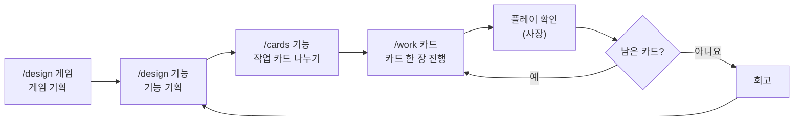

# unreal-claude-studio

**한국어** | [English](README.en.md)

Claude Code를 언리얼 엔진 게임 스튜디오처럼 쓰게 해 주는 설정 모음입니다. 혼자 게임을 만드는 사람이 "사장"이 되고, Claude가 기획, 작업 나누기, C++ 구현, 에디터 작업, 테스트, 코드 검토를 팀처럼 나눠 맡습니다.

- 언리얼 엔진 5.8, C++ 프로젝트, Windows 기준
- 에디터 작업은 에픽 공식 UE MCP 툴셋으로만 합니다
- 사장은 결정과 플레이 확인만 하고, 나머지는 정해진 절차대로 진행됩니다

## 한눈에 보기



카드 한 장(`/work`)은 이렇게 진행됩니다.

```
카드 시작(구현 방법 정하기) → 구현 → C++ 검토 → 에디터 작업 → 테스트 → 테스트 검토 → 플레이 확인 → 마무리
```

## 설치

### 필요한 것

- Windows, 언리얼 엔진 5.8(에픽 런처 설치본 권장), C++ 언리얼 프로젝트
- [Claude Code](https://code.claude.com) 2.1.295 이상
- Git for Windows(훅이 Git Bash로 돕니다), Git LFS
- 에픽이 만든 Claude Code 플러그인 `unreal-engine-skills-for-claude-code`(공식 마켓플레이스). Claude Code에서 `/plugin`으로 설치합니다

블루프린트만 있는 프로젝트는 에디터에서 C++ 클래스를 하나 추가해 C++ 프로젝트로 바꾼 뒤 설치합니다.

### 설치하기

```powershell
git clone https://github.com/Junghyeon0710/unreal-claude-studio.git
cd unreal-claude-studio
powershell -ExecutionPolicy Bypass -File install.ps1 "D:\Unreal Projects\MyGame"
```

`install.ps1`이 하는 일:

- `.claude/`(에이전트, 스킬, 규칙, 훅, 설정)와 `Scripts/`를 프로젝트에 복사합니다.
- `templates/`로 `CLAUDE.md`, `docs/`, `.gitignore`, `.gitattributes`, `.mcp.json`, 최소 테스트를 만들고 프로젝트 이름과 엔진을 채웁니다.
- `.uproject`에 `ModelContextProtocol`, `AllToolsets` 플러그인을 켜고, 개인 설정에 MCP 서버 자동 시작을 켭니다.
- **이미 있는 파일은 덮어쓰지 않습니다.** 내용이 다른 파일은 목록으로 알려 주니 직접 합칩니다. 여러 번 실행해도 됩니다.

### 설치한 뒤

1. 스크립트가 알려 주는 두 줄을 `Source/<프로젝트>/<프로젝트>.Build.cs`의 생성자에 넣습니다. 이렇게 Claude에게 부탁해도 됩니다: "설치 안내대로 Build.cs에 두 줄 넣어 줘".

   ```csharp
   PublicIncludePaths.Add(ModuleDirectory);   // 기능 폴더 헤더를 "<기능>/<파일>.h"로 include
   if (Target.bBuildEditor)
   {
       PrivateDependencyModuleNames.Add("CQTest");   // 월드가 필요한 자동 테스트
   }
   ```

2. 프로젝트 폴더에서 Claude Code를 열고 **폴더를 신뢰한다고 승인**합니다. 승인해야 훅이 동작합니다.
3. 확인합니다. Claude에게 "설치 확인해 줘"라고 해도 됩니다.
   - `Scripts\build.bat`: 빌드
   - `Scripts\test.bat`: 최소 테스트 `<프로젝트>.Smoke` 통과
   - `Scripts\editor.bat open`: 에디터를 켜고 MCP가 응답할 때까지 기다림
   - `Scripts\editor.bat close`: 에디터 끄기
4. Git 저장소가 아니면 `git init`, `git lfs install`을 합니다. 에셋(`.uasset`, `.umap`)은 LFS로 들어갑니다.

엔진 폴더는 스크립트가 `.uproject`의 엔진 버전으로 자동으로 찾습니다(에픽 런처 설치 목록 → 레지스트리). 다른 곳에 있으면 환경 변수 `UE_ROOT`에 엔진 폴더를 넣습니다.

## 사용법

Claude Code에서 슬래시 명령이나 평소 말로 부탁합니다. 대화는 한국어로 합니다(`CLAUDE.md`에서 바꿀 수 있습니다).

### 1. 게임 기획: `/design 게임`

Claude가 한 번에 하나씩 묻고, 묶음마다 정리해서 승인받은 것만 `docs/design/game.md`에 씁니다. 한 줄 소개, 핵심 재미 3가지, 첫 버전 기능, 만들 순서, 그만둘 조건까지 정합니다.

- 아이디어가 없으면 "모르겠어, 추천해 줘"라고 하세요. 좋아하는 게임을 하나 묻고 한 줄 컨셉 2~3개를 제안합니다.
- 질문을 줄이고 싶으면 "다 알아서 해"라고 하세요. 남은 칸을 추천안으로 채우고 마지막에 한 번만 확인받습니다.
- 확정 전에 처음 보는 눈(읽기 전용 서브에이전트)이 "이것만 보고 만들 수 있나"를 점검합니다.

### 2. 기능 기획: `/design dash`

기능 하나(예: 대시)의 규칙, 재는 기준, 조절 값, 예외 상황, 완료 조건을 정해서 `docs/design/dash.md`에 씁니다. 기능 이름은 영어 소문자로 씁니다. 무엇을 하는지만 쓰고, 어떻게 만드는지(클래스, C++와 블루프린트)는 쓰지 않습니다.

### 3. 작업 카드: `/cards dash`

확정된 기획서를 카드 2~5장으로 나눕니다(예: `docs/tasks/001-dash-move.md`). 기획서의 완료 조건은 빠짐없이 정확히 한 카드에 들어갑니다.

수치 조정이나 버그처럼 작은 일은 기획서 없이 카드 한 장으로 합니다: "대시할 때 벽에 끼는 버그 있어, 카드로 만들어 줘".

### 4. 카드 진행: `/work 001`

카드 한 장을 끝까지 진행합니다. 사장에게 묻는 때는 정해져 있습니다.

| 단계 | 하는 쪽 | 사장에게 묻는 것 |
|---|---|---|
| 카드 시작 | 메인 | 구조를 정하는 선택(추천안과 함께), 카드 승인 |
| 구현 | 메인 | 카드에 없는 구조 변경이 필요할 때만 |
| C++ 검토 | `ue-reviewer` | 없음 |
| 에디터 작업 | `ue-editor` | 에셋을 여러 개 바꾸기 전 커밋할지 |
| 테스트 | `ue-qa` | 테스트 방식을 정해야 할 때만 |
| 테스트 검토 | `ue-reviewer` | 없음 |
| 플레이 확인 | 사장 | 체크리스트대로 해 보고 좋은지 |
| 마무리 | 메인 | 커밋할지 |

- 에디터는 Claude가 켜고 끕니다(`Scripts\editor.bat`). 끄기 전에 저장하고, 강제로 끄지 않습니다.
- 같은 문제로 3번 넘게 고치면 멈추고 알립니다.
- 사장에게 묻지 않고 정한 것은 카드에 `판단:`으로 남깁니다.

### 5. 이어서 하기

새 대화를 열면 대화 시작 훅이 진행 중인 카드, 다음 할 일, 커밋 안 한 변경, 에디터 상태를 Claude에게 알려 줍니다. "이어서 하자"라고만 하면 됩니다. 카드의 "진행 기록"에서 멈춘 단계부터 이어서 합니다.

### 6. 회고

기능의 카드가 다 끝나면 Claude가 진행 기록에서 스튜디오 때문에 막힌 곳을 모아 보여 주고 `docs/progress.md`의 "스튜디오 개선"에 적습니다. 스튜디오 설정은 그 자리에서 고치지 않고 따로 상의해서 고칩니다.

## 팀

| 이름 | 역할 | 쓸 수 있는 곳 |
|---|---|---|
| 메인 Claude | 기획 대화, 카드 나누기, C++ 구현, 에디터 켜고 끄기, 팀 조율 | 프로젝트 전체 |
| `ue-editor` | 에디터 안 작업(블루프린트, 입력, 레벨, 에셋). 공식 툴셋만 쓰고, 도구가 없으면 우회하지 않고 필요한 도구를 보고 | 자기 기억 폴더 |
| `ue-qa` | 자동 테스트(Automation Spec, CQTest) 작성과 실행, 플레이 체크리스트 | 테스트 폴더, `docs/tasks/`, 기억 폴더 |
| `ue-reviewer` | C++, 테스트, 프로젝트 툴셋 검토. 에픽 C++ 코딩 표준 기준. 지적만 하고 고치지 않음 | 자기 기억 폴더(Bash는 git 읽기만) |
| `ue-programmer` | 서로 독립된 카드를 따로 맡길 때의 C++ 구현 | `Source/`, `Plugins/`, `docs/tasks/` |

쓸 수 있는 곳은 훅이 막습니다. 엔진 폴더나 다른 프로젝트에도 쓰지 못합니다.

## 들어 있는 것

설치하면 프로젝트에 이렇게 생깁니다.

```
<프로젝트>/
├── CLAUDE.md                     프로젝트 설명서: 엔진, 명령, 폴더, 팀, 작업 흐름, 규칙
├── .mcp.json                     UE MCP 주소 (http://127.0.0.1:8000/mcp)
├── .claude/
│   ├── agents/                   ue-editor, ue-qa, ue-reviewer, ue-programmer
│   ├── skills/
│   │   ├── design/               /design 기획실과 기획서 양식(게임, 기능)
│   │   ├── cards/                /cards 작업 카드와 카드 양식
│   │   ├── work/                 /work 카드 진행
│   │   └── editor-tool-request/  공식 도구가 없을 때의 절차
│   ├── rules/
│   │   ├── ue-cpp.md             C++ 규칙(C++ 파일을 열면 자동으로 읽힘)
│   │   ├── ue-blueprint-cpp.md   C++와 블루프린트 나누기
│   │   └── ue-assets.md          에셋 이름(접두사)과 폴더
│   ├── hooks/                    쓰기 범위 제한, git 읽기 전용, 대화 시작 요약
│   └── settings.json             .uasset/.umap 직접 수정 금지, 대화 시작 훅 연결
├── Scripts/
│   ├── build.bat                 에디터 대상 빌드
│   ├── test.bat                  명령줄 자동 테스트 (예: test.bat MyGame.Dash)
│   ├── editor.bat                에디터 open | close | status
│   ├── ue-root.ps1               엔진 폴더 찾기
│   └── ue-python.bat             승인한 일회용 에디터 스크립트 실행
├── docs/
│   ├── progress.md               진행 기록, 다음 할 일, 스튜디오 개선
│   ├── design/                   기획서
│   └── tasks/                    작업 카드
└── Source/<프로젝트>/Tests/<프로젝트>SmokeSpec.cpp   항상 통과하는 최소 테스트
```

## 규칙과 안전장치

- **에셋 보호:** `.uasset`, `.umap`은 파일로 직접 고치지 못하게 막혀 있습니다. 에셋은 에디터에서만 바꿉니다.
- **쓰기 범위:** 에이전트마다 쓸 수 있는 폴더가 정해져 있고 훅이 막습니다. 훅이 실행되지 못하면 통과시키지 않고 막습니다(`onFailure: block`).
- **에디터:** 강제로 끄지 않습니다. 저장 창이 떠 있으면 기다리다 알립니다.
- **커밋:** 사장이 원할 때만 합니다. 에셋을 여러 개 바꾸기 전에는 커밋할지 먼저 묻습니다.
- **추측 금지:** 엔진 API가 확실하지 않으면 엔진 소스에서 실제 선언을 확인합니다.
- **C++ 규칙:** 언리얼 기본, 에픽 C++ 코딩 표준, 읽기 쉬운 코드, 구조와 의존성(`ue-cpp.md`). C++가 기반이고 블루프린트는 에셋 연결, 겉모습, UI 배치, 시제품에 씁니다(`ue-blueprint-cpp.md`).

## 에디터와 MCP

- 메인 대화는 대화를 시작할 때 에디터가 켜져 있어야 MCP(`.mcp.json`)에 연결됩니다.
- 그래서 `ue-editor`, `ue-qa`, `ue-programmer`는 에이전트 설정의 `mcpServers`(이름 `unreal-editor`)로 부를 때마다 스스로 연결합니다. 대화 중에 에디터를 켜도 에디터 작업을 할 수 있습니다.
- `Scripts\editor.bat open`은 MCP 서버 시작 옵션을 넘겨서, 자동 시작 설정이 꺼져 있어도 서버가 뜹니다.

## 공식 도구가 없을 때

에픽 권장(`create-toolset` 스킬)대로 우회하지 않고 도구를 만듭니다.

1. `ue-editor`가 "필요한 도구"(하는 일, 입력, 출력)를 보고하고 멈춥니다.
2. 메인이 사장에게 묻고, 승인받으면 프로젝트 툴셋(`Plugins/<프로젝트>Tools/`, 파이썬 우선)에 도구와 테스트를 만듭니다.
3. `ue-reviewer` 검토 → 에디터에 반영(첫 도구는 에디터를 다시 켜기) → `ue-editor`를 새로 불러 이어서 작업합니다.

한 번만 할 작업(예: 에셋 수백 개 이름 일괄 변경)만 예외로, 일회용 스크립트를 승인받은 뒤 `Scripts\ue-python.bat`로 실행합니다. 이때는 Python Remote Execution(프로젝트 설정 > 플러그인 > Python)이 켜져 있어야 합니다.

## 문제 해결

| 증상 | 확인할 것 |
|---|---|
| 스크립트가 엔진을 못 찾음 | 환경 변수 `UE_ROOT`에 엔진 폴더(`Engine` 폴더가 들어 있는 곳)를 넣습니다 |
| 에디터는 켜졌는데 MCP가 응답 안 함 | `Scripts\editor.bat open`으로 켰는지 봅니다. 런처로 켰다면 `.uproject`에 `ModelContextProtocol`, `AllToolsets`가 켜져 있는지, 개인 설정의 `bAutoStartServer=True`를 봅니다. 다른 프로젝트 에디터가 같은 포트(8000)를 쓰고 있지 않은지도 봅니다 |
| 메인 대화에서 `unreal-mcp` 연결 실패 | 대화를 시작할 때 에디터가 꺼져 있었던 것입니다. 에디터 작업은 `ue-editor`에게 맡기면 됩니다(스스로 연결합니다) |
| `editor.bat close`가 안 끝남 | 저장 창이 떠 있을 수 있습니다. 스크립트가 알려 주는 창 목록을 보고 에디터에서 직접 닫습니다. 강제로 끄지 않습니다 |
| 훅이 동작하지 않음 | 프로젝트 폴더를 신뢰한다고 승인했는지, Git Bash가 있는지, Claude Code가 2.1.295 이상인지 봅니다 |
| 테스트가 0개라고 나옴 | 최소 테스트 `Source/<프로젝트>/Tests/<프로젝트>SmokeSpec.cpp`가 있는지 봅니다 |
| 에이전트 설정을 고쳤는데 그대로임 | 에이전트 설정은 새 대화부터 적용됩니다 |

## 바꿔 쓰기

- **MCP 포트:** `.mcp.json`과 세 에이전트(`ue-editor`, `ue-qa`, `ue-programmer`)의 `mcpServers` 주소를 같이 바꿉니다.
- **대화 언어:** `CLAUDE.md` 첫 문단의 "사용자와는 한국어로 대화한다"를 바꿉니다.
- **규칙:** `.claude/rules/`의 파일을 고칩니다. 에셋 접두사는 `ue-assets.md`에 있습니다.

## 알려진 제한

- Windows만 지원합니다(배치 파일, PowerShell).
- UE 5.8 기준으로 만들었습니다. 다른 버전은 툴셋과 템플릿 이름이 다를 수 있습니다.
- 블루프린트만 있는 프로젝트는 C++ 클래스를 하나 추가해야 합니다.
- 소스로 빌드한 엔진은 레지스트리로 찾도록 되어 있지만 시험하지 않았습니다.
- 에이전트가 쌓는 기억(`.claude/agent-memory/`)은 프로젝트마다 따로입니다.

## 만든 방법과 참고

이 스튜디오는 프로젝트 하나로 리허설(연습 기능을 기획부터 플레이 확인까지)을 해 보고, 막힌 곳을 고쳐 가며 만들었습니다. 참고한 것:

- 에픽: UE MCP와 공식 툴셋, `unreal-engine-skills-for-claude-code` 플러그인, [Recommended Asset Naming Conventions](https://dev.epicgames.com/documentation/en-us/unreal-engine/recommended-asset-naming-conventions-in-unreal-engine-projects), [Blueprint vs. C++](https://dev.epicgames.com/documentation/en-us/unreal-engine/coding-in-unreal-engine-blueprint-vs-cplusplus), 에픽 C++ 코딩 표준
- [Claude Code 문서](https://code.claude.com/docs): 스킬, 서브에이전트, 훅
- 작업 방식: [Superpowers](https://github.com/obra/superpowers)(계획 쓰기, 서브에이전트 진행), [GitHub spec-kit](https://github.com/github/spec-kit)(기획과 작업 나누기), [Claude Code Game Studios](https://github.com/Donchitos/Claude-Code-Game-Studios)(게임 스튜디오 구성)
